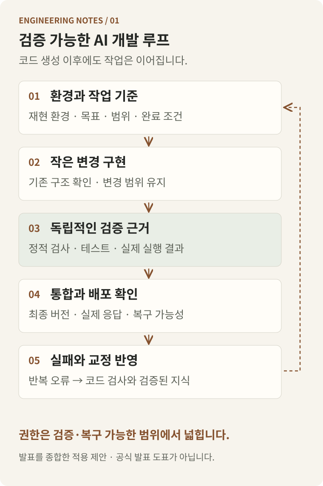
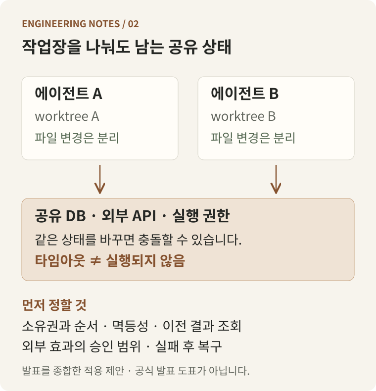

## 들어가며

AI에게 코드를 맡길 때 가장 궁금한 것은 결국 비슷합니다.

```text
어떻게 하면 더 빨리 만들 수 있을까?
그리고 만들어진 결과를 어디까지 믿어도 될까?
```

AI Engineer CODE 2026의 공개 자료를 종합하면서 두 번째 질문에 더 주목했습니다. 모델이 구현을 빨리 해주더라도 명세가 모호하거나, 테스트가 잘못됐거나, 배포한 결과를 확인하지 않으면 전체 작업은 끝나지 않기 때문입니다.

이 글은 발표를 순서대로 옮긴 전사본이 아닙니다. 여러 발표에서 반복된 문제를 하나의 개발 흐름으로 묶고, 백엔드 개발과 AI 코딩 도구 사용에 어떻게 적용할지 정리한 글입니다. **발표에서 확인한 내용과 아래의 적용 제안은 구분해서 읽으면 좋겠습니다.**



*그림 1. 발표들의 공통점을 개발 흐름으로 묶은 적용 제안입니다. 공식 발표 슬라이드가 아닙니다.*

### 먼저, 어디까지 확인했는가

- 11월 11~12일 본행사의 메인 기술 발표 **32개**를 대상으로 정리했습니다.
- 일정상 메인·Expo·폐막을 합친 항목은 51개입니다. **Expo 18개와 폐막 1개는 실제 내용을 확인하지 못했습니다.** 전체 현장 발표를 모두 다룬 글은 아닙니다.
- 별도로 정리한 온라인 프로그램 **23개**도 종합 과정에 참고했습니다. 현장 발표 32개와 같은 집합으로 세지 않습니다.
- 공식 [reading edition 목록](https://ai.engineer/code/2026/talks)은 메인 32개와 온라인 18개를 묶은 50개 기준입니다. 위 온라인 정리 23개와도 범위가 다릅니다.
- 이 글은 기존에 정리한 전사·발표 자료 요약을 다시 읽고 통합한 결과입니다. 원영상 전체 재시청이나 발표자가 제시한 실험의 재현 결과는 아닙니다.

공식 전사에도 음성 인식 오류와 누락이 있습니다. 무음 시연이나 슬라이드의 내용을 모두 복원해주는 자료도 아닙니다. 특히 Philipp Schmid의 자료는 부분 전사이며, Jarred Sumner의 공개 영상은 예정된 45분 슬롯 전체가 아닌 약 22분 분량입니다. Lydia Hallie의 근거에는 대체 녹화본이 사용됐습니다. 발표 속 성과 수치는 해당 발표자의 사례로 읽어야 합니다.

## 1. 반복되는 실수는 프롬프트 밖으로 옮긴다

Lauren Tan의 발표는 코드 패턴, API, 정적 분석, 타입과 테스트로 실수할 수 있는 경로 자체를 줄이는 접근을 다룹니다. Lydia Hallie의 발표와 Philipp Schmid의 하네스 단순화 사례도, 지침과 도구를 계속 늘리는 것이 항상 좋은 방향은 아니라는 점을 생각하게 합니다.

관련 자료: [Lauren Tan](https://ai.engineer/code/2026/talks/lauren-tan), [Lydia Hallie](https://ai.engineer/code/2026/talks/lydia-hallie), [Philipp Schmid](https://ai.engineer/code/2026/talks/philipp-schmid).

제가 적용한다면 반복되는 리뷰 의견을 먼저 분류할 것 같습니다.

| 반복되는 문제 | 먼저 검토할 수단 |
| --- | --- |
| 금지된 의존성이나 레이어 침범 | 의존성 검사, 아키텍처 테스트 |
| 포맷, 이름, 단순한 코드 규칙 | 포매터, 린트, Checkstyle |
| 같은 비즈니스 규칙을 여러 곳에서 다르게 구현 | 공통 API와 모듈 경계 정리 |
| 저장소만 봐서는 알 수 없는 결정 배경 | 짧은 문서와 근거 링크 |
| 상황마다 정답이 달라지는 판단 | 사람의 검토와 결정 이유 기록 |

AI에게 매번 긴 규칙을 다시 읽게 하는 것보다, 기계적으로 판정할 수 있는 규칙은 실행 가능한 검사로 만드는 편이 일관적입니다. 다만 모든 판단을 린트로 옮길 수는 없습니다. 코드로 강제할 규칙과 맥락을 읽고 판단할 문제를 나누는 것이 먼저입니다.

하네스를 줄이는 것도 같은 기준으로 봅니다. Philipp의 사례는 비용과 캐시 효율의 변화를 보여주지만, 제한된 평가에서 나온 결과입니다. 다른 저장소에서도 무조건 도구를 없애야 한다는 결론으로 가져오면 곤란합니다.

## 2. 작업을 시작하기 전에 완료 조건을 정한다

Jarred Sumner는 검증할 수 있는 프로젝트를 고르는 관점에서 독립적인 테스트와 비교 기준의 중요성을 설명합니다. Luke Alvoeiro는 작업의 목표, 책임자, 환경과 기억을 유지하면서 검증된 범위부터 자율성을 높이는 방식을 소개합니다.

관련 자료: [Jarred Sumner](https://ai.engineer/code/2026/talks/jarred-sumner), [Luke Alvoeiro](https://ai.engineer/code/2026/talks/luke-alvoeiro).

여기서 가져온 적용 제안은 간단합니다. “이 기능을 만들어줘” 다음에 무엇을 보면 완료로 인정할지 붙이는 것입니다.

```yaml
goal: 사용자가 얻어야 하는 결과
non_goals: 이번 작업에서 바꾸지 않을 것
scope: 변경 가능한 파일, 서비스, 데이터
invariants: 반드시 유지해야 하는 기존 동작
acceptance: 관측 가능한 합격 조건
evidence: 테스트, 로그, API 응답 등 필요한 근거
risk: 데이터 손실, 권한, 호환성, 외부 효과
budget: 시간, 비용, 재시도 횟수의 한도
rollback: 코드와 데이터, 외부 효과의 복구 방법
stop_when: 요구사항 충돌, 권한 부족, 결과 불명확
```

모든 작은 작업에 이 양식을 길게 채울 필요는 없습니다. 오타 수정이라면 범위와 확인 방법만 있어도 됩니다. 반대로 결제나 데이터 마이그레이션이라면 불변 조건과 복구 방법을 생략하기 어렵습니다.

명세를 YAML로 썼다고 사용자의 의도가 증명되는 것도 아닙니다. 서로 모순되는 요구사항은 형식만 바꾸지 말고 구현 전에 해소해야 합니다.

## 3. 검증자도 틀릴 수 있다

Brian Kennedy의 발표는 판단 모델 역시 작업자의 그럴듯한 완료 설명을 믿을 수 있다는 문제를 다룹니다. Luke Alvoeiro의 사례에서는 검증 대상 PR과 승인 정책의 출처를 분리합니다. PR을 검사하더라도 정책은 mainline에서 읽어, 작업자가 자기 승인 기준까지 바꾸지 못하도록 하는 방식입니다.

관련 자료: [Brian Kennedy](https://ai.engineer/code/2026/talks/brian-kennedy), [Luke Alvoeiro](https://ai.engineer/code/2026/talks/luke-alvoeiro).

이 두 발표를 연결하면 “다른 AI가 한 번 더 읽었으니 안전하다”는 구조만으로는 부족하다는 생각이 듭니다.

```text
구현자의 완료 설명
        ↓
다른 모델의 동의
```

여기에 실제 변경, 실행 결과, 검사 대상 버전이 빠져 있다면 둘 다 같은 착각을 할 수 있습니다.

적용할 때는 다음을 구분하려고 합니다.

- 테스트가 실행됐는가, 아니면 실행할 명령만 제시됐는가?
- 통과한 테스트는 최종 변경 버전에 대한 것인가?
- 실패를 고친 것인가, 테스트나 게이트를 약화한 것인가?
- 실제 API 응답과 배포 상태까지 확인했는가?
- 실행하지 못한 검사는 무엇인가?

검증에 토큰을 무제한으로 쓰는 방향도 피하고 싶습니다. **기본 검증은 정적 검사, 빌드, 테스트로 두고, AI 리뷰는 설계 판단이나 위험한 변경에 선택적으로 사용하는 것**이 현실적인 출발점이라고 봅니다. 이는 발표자들의 공동 표준이 아니라, 비용과 검증 가능성을 함께 고려한 이 글의 적용 제안입니다.

## 4. 에이전트를 병렬로 돌리면 공유 상태가 문제가 된다

Ankit Mathur는 코드뿐 아니라 데이터, 컴퓨트, 권한, 대화와 메모리까지 분기하는 접근을 소개합니다. Fabian Hedin은 장시간 실행을 위해 프로세스, 영구 작업 이력, 모델에 전달하는 문맥을 분리합니다. 온라인의 Girish Konda 발표도 서브에이전트의 부분 완료와 재시도를 분산시스템 문제로 다룹니다.

관련 자료: [Ankit Mathur](https://ai.engineer/code/2026/talks/ankit-mathur), [Fabian Hedin](https://ai.engineer/code/2026/talks/fabian-hedin), [Girish Konda](https://ai.engineer/code/2026/talks/online-subagent-distributed-systems).



*그림 2. 파일 격리와 외부 효과의 격리는 서로 다른 문제입니다.*

Git worktree를 나누면 파일 충돌은 줄일 수 있습니다. 하지만 두 작업이 같은 DB나 외부 API를 사용한다면 공유 상태는 그대로 남아 있습니다.

예를 들어 한 에이전트가 결제 API를 호출하다 타임아웃됐다고 해보겠습니다. 응답을 받지 못했다는 사실만으로 결제가 실행되지 않았다고 결론 내릴 수는 없습니다. 다른 에이전트에게 바로 재시도시키면 중복 효과가 생길 수 있습니다.

그래서 병렬 실행 전에 정할 것이 있습니다.

1. 각 작업이 소유하는 파일과 기능은 무엇인가?
2. 공유 DB, 외부 API, 권한은 어떻게 분리하는가?
3. 타임아웃 이후 이전 실행 결과를 어디서 확인하는가?
4. 같은 요청이 다시 들어와도 안전한가?
5. 결과를 확인할 수 없으면 누가 판단하는가?

독립적인 조사와 테스트는 병렬화하기 좋습니다. 같은 상태를 바꾸는 작업은 의존성을 먼저 정리해야 합니다. 에이전트 수를 늘리기 전에 이 경계를 그리는 것이 우선입니다.

## 5. 코드 생성 속도와 업무 완료 속도를 나눠 본다

Natalie Serrino는 단일 요청의 지연, 전체 처리량, 마감시간 내 처리량을 서로 다른 목표로 설명합니다. 추론이 빨라지면 도구 실행이 다음 병목이 될 수 있다는 점도 보여줍니다. 발표의 10배 추론 가속 예시는 시뮬레이션이며, 애플리케이션이 실제로 10배 빨라졌다는 결과는 아닙니다.

관련 자료: [Natalie Serrino](https://ai.engineer/code/2026/talks/natalie-serrino).

개발 작업에도 같은 구분을 적용할 수 있습니다.

```text
요구사항 정리 → 구현 → 빌드·테스트 → 리뷰 → 병합 대기 → 배포 → 결과 확인
```

구현이 10분 빨라져도 CI가 오래 걸리고 리뷰 대기열이 밀려 있다면 사용자가 결과를 받는 시간은 거의 달라지지 않을 수 있습니다.

그래서 지표도 작업 전체를 보도록 잡아야 한다고 생각합니다.

- 성공적으로 전달한 작업당 총비용
- 시작부터 배포 확인까지 걸린 시간
- CI와 리뷰에서 기다린 시간
- 사람이 개입하거나 다시 작업한 시간
- 병합 이후 리버트와 후속 수정 비율
- 잘못된 완료 선언의 빈도

PR 수, 코드 줄 수, 토큰 사용량도 관찰할 수는 있습니다. 다만 활동량이 늘었다는 사실만으로 결과가 좋아졌다고 판단하기는 어렵습니다.

## 6. 배포 이후와 복구까지가 작업의 범위다

Andrew Finch는 검증을 PR, 배포 이후, 유지보수, 지식이라는 여러 루프로 나눕니다. Justin McCarthy는 기존 시스템에서 이미 사용자에게 한 약속을 보존하는 문제를 다룹니다.

관련 자료: [Andrew Finch](https://ai.engineer/code/2026/talks/andrew-finch), [Justin McCarthy](https://ai.engineer/code/2026/talks/justin-mccarthy).

테스트가 통과하고 PR이 병합됐더라도 운영에서 정상 동작하는지는 별개의 질문입니다. 배포된 버전, 실제 응답, 오류율과 로그를 확인해야 합니다.

복구도 `git revert` 하나로 묶지 않는 편이 좋겠습니다.

| 바뀐 대상 | 확인할 복구 방식 |
| --- | --- |
| 코드 | 이전 버전 배포 또는 revert |
| DB 구조와 데이터 | 호환성, 백업, 복원 가능성 |
| 외부 결제나 발송 | 상태 조회와 승인된 보상 작업 |
| 사용자에게 공개된 결과 | 정정, 회수 가능성, 후속 안내 |

코드를 되돌려도 이미 보낸 메시지나 실행한 결제가 자동으로 취소되지는 않습니다. 자동화 범위를 넓힐 때는 성공 경로뿐 아니라 실패 이후의 상태를 확인할 수 있어야 합니다.

## 7. 실패와 기억을 다음 작업의 입력으로 만든다

Lance Martin의 발표는 작업 중 기록과 정리된 기억의 관계를 생각하게 합니다. Melvin Johnson은 여전히 실패하는 실제 엔지니어링 과제를 학습과 평가에 사용하는 문제를 다룹니다. Zach Bruggeman은 실제 작업 과정과 근거가 조직 안에서 공유될 때의 효과를 소개합니다.

관련 자료: [Lance Martin](https://ai.engineer/code/2026/talks/lance-martin), [Melvin Johnson](https://ai.engineer/code/2026/talks/melvin-johnson), [Zach Bruggeman](https://ai.engineer/code/2026/talks/zach-bruggeman).

적용할 때는 모든 로그를 영구 지침으로 쌓기보다 다음을 나누고 싶습니다.

- **작업 기록:** 무엇을 시도했고 어떤 결과가 나왔는가.
- **검증된 지식:** 다음 작업에서도 유효한 결정과 근거는 무엇인가.
- **회귀 사례:** 같은 실수를 다시 잡을 수 있는 테스트는 무엇인가.
- **폐기할 정보:** 일시적 우회책이나 더 이상 맞지 않는 설명은 무엇인가.

실패를 모델 탓으로만 분류하지 않는 것도 중요합니다. 명세가 틀렸는지, 실행 환경이 깨졌는지, 도구가 실패했는지, 검증자가 잘못 판정했는지에 따라 고쳐야 할 곳이 다릅니다.

이 과정을 팀에서 공유하더라도 대화와 로그를 무조건 공개할 필요는 없습니다. 접근 권한과 민감 정보의 경계는 따로 유지해야 합니다.

## 8. 백엔드 작업 하나에 적용해보면

아래는 발표에 나온 구현을 복제한 것이 아니라, 앞의 원칙을 **주문 API의 중복 결제 방지**에 적용한 예시입니다.

### 작업의 계약

```text
목표: 같은 결제 의도가 두 번 청구되지 않도록 한다.
범위: 결제 요청 처리, 상태 조회, 재시도 경로.
유지 조건: 기존 정상 결제와 취소 흐름의 계약을 깨지 않는다.
중요한 실패: 외부 결제는 성공했지만 응답을 받기 전에 타임아웃된다.
완료 기준: 중복 요청, 동시 요청, 타임아웃, 재시작 뒤 상태를 검증한다.
```

### 실행 순서

1. 기존 호출 흐름, 상태 모델, 테스트와 외부 API의 보장을 읽습니다.
2. 멱등성 키와 상태 조회 방법, 로컬 상태 전이를 정합니다.
3. 정상 경로뿐 아니라 타임아웃 이후 재시도를 재현합니다.
4. 작은 변경을 구현하고 빠른 검사부터 실행합니다.
5. 경합, 중복 전달, 프로세스 재시작을 포함한 통합 검증을 수행합니다.
6. 최종 버전의 명령과 결과, 실행하지 못한 검사를 남깁니다.
7. 실제 결제나 환불 같은 외부 효과는 별도의 권한과 승인 범위 안에서 다룹니다.

이 예시에서 중요한 것은 “retry를 넣었다”가 완료 조건이 아니라는 점입니다. 이전 호출이 성공했는지 모르는 상태까지 작업 명세에 들어가야 합니다.

## 9. 내 AI에 적용한다면 이 정도부터

여러 발표를 보고 새로운 스킬과 지침부터 잔뜩 추가하고 싶어질 수 있습니다. 하지만 처음에는 작은 작업 하나에서 기준선을 만드는 편이 낫다고 생각합니다.

아래 문구는 **이 글의 적용 제안**입니다. 기존 `AGENTS.md`나 프로젝트 규칙을 덮어쓰는 용도가 아니라, 중복과 충돌을 확인한 뒤 필요한 부분만 합치는 출발점입니다.

```text
작업 전에 저장소의 지침, 기존 구현, 테스트와 빌드 방법을 확인한다.
목표, 비목표, 변경 범위, 유지할 조건과 완료 기준을 정리한다.
확인한 사실과 추측을 구분하고, 결과를 바꾸는 모호함은 구현 전에 해소한다.

작은 검증 가능한 변경으로 진행한다.
기존 추상화를 확인하고, 관련 없는 리팩터링을 섞지 않는다.
테스트를 지우거나 검사 기준을 약하게 만들어 실패를 숨기지 않는다.

빠른 정적 검사와 단위 테스트부터 실행하고, 위험에 맞는 통합 검증을 더한다.
AI의 전체 코드 재리뷰를 기본값으로 두지 않는다.
설계, 보안, 데이터와 호환성 등 판단이 필요한 변경에 검토를 집중한다.

병렬 작업은 파일 소유권, 의존성과 공유 상태를 먼저 정한다.
타임아웃을 미실행으로 단정하지 않는다.
외부 효과는 승인된 범위에서만 실행하고 실제 상태를 확인한다.

완료 시 변경 내용, 실행한 명령과 실제 결과,
실행하지 못한 검사, 남은 위험을 구분해서 보고한다.
반복된 객관적 실수는 지침을 늘리기 전에 코드 검사로 옮길 수 있는지 검토한다.
```

처음부터 무제한 에이전트, 모든 PR 자동 병합, 모든 문제에 형식 검증을 도입할 필요는 없습니다. 대표 작업 몇 개에서 성공률, 재작업, 비용과 사람의 검토 시간을 보고 하나씩 바꾸면 됩니다.

## 마무리

이번 자료들을 연결해보니 AI 개발 도구의 활용 범위가 넓어질수록 주변 개발 시스템의 품질도 중요해진다는 생각이 들었습니다.

코드베이스가 읽기 쉽고, 작업의 경계가 명확하고, 검증 결과를 확인할 수 있고, 잘못됐을 때 복구할 수 있어야 더 많은 일을 맡길 수 있습니다. 판단과 책임을 어디에 남길지도 함께 정해야 합니다.

저라면 모델이나 에이전트 수를 바꾸기 전에 작은 작업 하나에서 다음 흐름이 실제로 이어지는지 확인해보겠습니다.

```text
재현 가능한 환경
→ 명확한 작업 기준
→ 작은 구현
→ 독립적인 검증 근거
→ 통합과 배포 확인
→ 실패에서 배운 것을 다음 검사로 반영
```

이 흐름을 갖추는 것이, 발표에서 나온 여러 도구와 기법을 자기 프로젝트에 가져오기 위한 출발점이라고 생각합니다.

## 발표별 공식 자료

영어 전사 전체를 이 글에 재배포하지 않고 공식 자료로 연결합니다. 공식 사이트에서 제공하는 [전체 전사 ZIP](https://ai.engineer/api/code/reading-download/transcripts.zip)도 사용할 수 있습니다. 내려받을 때의 수록 범위는 [공식 목록](https://ai.engineer/code/2026/talks)을 확인하는 것이 좋습니다.

- [행사 안내](https://ai.engineer/code/2026)
- [전체 일정](https://ai.engineer/code/2026/schedule)
- [전사·reading edition 목록](https://ai.engineer/code/2026/talks)

### 본행사 메인 32개

- [Natalie Serrino · What will you build when AI is 10× faster?](https://ai.engineer/code/2026/talks/natalie-serrino)
- [Philipp Schmid · I deleted 90% of my harness (And It Got Better)](https://ai.engineer/code/2026/talks/philipp-schmid)
- [Ankit Mathur · The Rise of the Agent Workforce](https://ai.engineer/code/2026/talks/ankit-mathur)
- [Andrew Finch · Building a Safe Software Factory](https://ai.engineer/code/2026/talks/andrew-finch)
- [Luke Alvoeiro · Earning Autonomy: From Missions to Workstreams](https://ai.engineer/code/2026/talks/luke-alvoeiro)
- [Brian Kennedy · Your Judge Is Hallucinating Too](https://ai.engineer/code/2026/talks/brian-kennedy)
- [Fabian Hedin · What it takes to set intelligence free](https://ai.engineer/code/2026/talks/fabian-hedin)
- [Zach Bruggeman · How to build an agent that builds the culture](https://ai.engineer/code/2026/talks/zach-bruggeman)
- [Simon Willison · 2026 in LLMs](https://ai.engineer/code/2026/talks/simon-willison)
- [Jason Liu · Ambition in AI](https://ai.engineer/code/2026/talks/jason-liu)
- [Zach Lloyd · Software Engineering Is Becoming Factory Engineering](https://ai.engineer/code/2026/talks/zach-lloyd)
- [Walden Yan · A New Age of Software Engineering](https://ai.engineer/code/2026/talks/walden-yan)
- [Jeffrey Pinner · What Your AI Doesn't Know](https://ai.engineer/code/2026/talks/jeffrey-pinner)
- [Doug Clauson · Ship More as a Team of One with Kiro Crew](https://ai.engineer/code/2026/talks/doug-clauson)
- [Lance Martin · Exploring Claude's Frontier](https://ai.engineer/code/2026/talks/lance-martin)
- [Jarred Sumner · Choose the project you can verify](https://ai.engineer/code/2026/talks/jarred-sumner)
- [Ishaan Dey · Judgement is the last job](https://ai.engineer/code/2026/talks/ishaan-dey)
- [Melvin Johnson · Train on the engineering work that still fails](https://ai.engineer/code/2026/talks/melvin-johnson)
- [Quinn Slack · Build the company around the agent, not a pilot project](https://ai.engineer/code/2026/talks/quinn-slack)
- [Dexter Horthy · A software factory needs pressure in both directions](https://ai.engineer/code/2026/talks/dexter-horthy)
- [Thariq Shihipar · Keep the human inside the creative loop](https://ai.engineer/code/2026/talks/thariq-shihipar)
- [Lydia Hallie](https://ai.engineer/code/2026/talks/lydia-hallie)
- [Lauren Tan](https://ai.engineer/code/2026/talks/lauren-tan)
- [Michelle Chen](https://ai.engineer/code/2026/talks/michelle-chen)
- [Diogo Almeida](https://ai.engineer/code/2026/talks/diogo-almeida)
- [Chinmay Goyal](https://ai.engineer/code/2026/talks/chinmay-goyal)
- [Chibi Vikram + Kevin Bernstein](https://ai.engineer/code/2026/talks/uipath)
- [Scott Roberts](https://ai.engineer/code/2026/talks/scott-roberts)
- [Steve Yegge](https://ai.engineer/code/2026/talks/steve-yegge)
- [Armin Ronacher](https://ai.engineer/code/2026/talks/armin-ronacher)
- [Brandon Thomas](https://ai.engineer/code/2026/talks/brandon-thomas)
- [Justin McCarthy](https://ai.engineer/code/2026/talks/justin-mccarthy)

메인 32개 링크는 조사 범위를 찾기 위한 색인입니다. 각 발표를 같은 깊이로 재현하거나 모든 주장을 검증했다는 뜻은 아닙니다. 온라인 발표는 위 공식 목록에서 별도로 확인할 수 있습니다.
