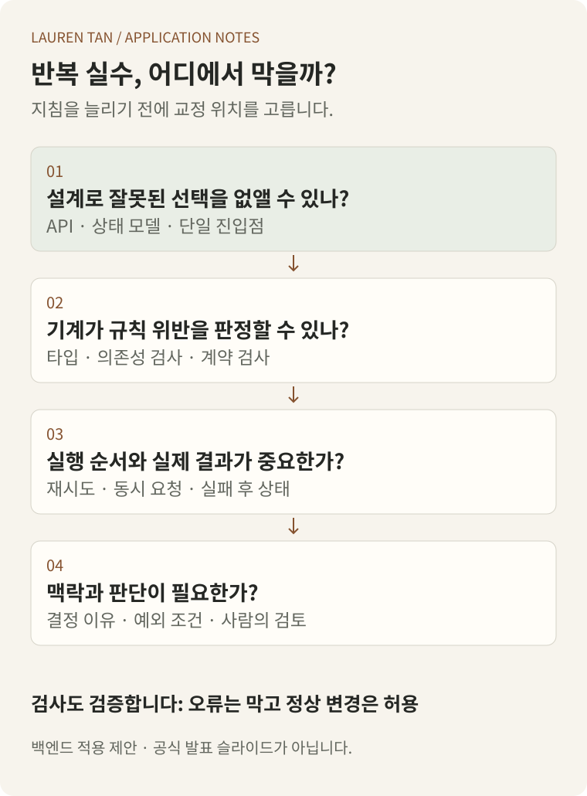

## 이 발표가 던지는 질문

AI가 같은 실수를 반복하면 지침을 더 자세히 쓰면 될까요? Lauren Tan의 발표를 읽으며 가져갈 질문은 조금 다릅니다. **그 실수를 다시 지적하지 않아도 되는 개발 환경을 만들 수 있을까?**

이 글은 AI Engineer CODE 2026 발표별 정리입니다. 전사 전체를 번역한 글이 아니라, 핵심 요약과 독자적인 적용 메모를 나눠 구성했습니다. [전체 발표 종합 글](/posts/ai-engineer-code-2026-engineering-workflow/)과 함께 읽어도 좋습니다.

## 발표 핵심 요약

Tan은 에이전트를 신뢰하기 위한 투자 순서를 제시합니다. 좋은 API와 구조, 린트·타입·테스트로 선택지를 제한하고, 실행 및 형식 검증을 겹칩니다. 문서 지침은 판단이 필요한 부분에 보탭니다. 코드베이스 자체가 다음 생성의 입력이므로 낡은 우회 구현도 계속 복제될 수 있다는 설명입니다.

Dune 사례에서는 제품 코드의 `useEffect` 사용을 제한하고, Electron의 main과 renderer 사이에 금지된 의존성이 생기지 않도록 검사합니다. 특정 팀의 설계 선택이지 모든 React 프로젝트에 적용할 금지 목록은 아닙니다.

검토 대상도 코드 차이만이 아닙니다. 실제 실행 결과와 상태 전이, 검증 근거를 살펴보며, 내부 작업 과정의 신뢰도를 높인 뒤 반복 실행을 자동화하는 순서입니다.

출처: [공식 발표 페이지 및 기계 생성 전사](https://ai.engineer/code/2026/talks/lauren-tan). 관련 구간은 원본 영상 기준 1:03:27~1:04:20, 1:06:24~1:08:18, 1:11:00 이후입니다. 전사에는 인식 오류가 있으며, 이 글은 발표 성과를 독립적으로 재현한 결과가 아닙니다.

## 적용 메모: 리뷰 지적을 어디에 둘 것인가

**이하의 분류와 그림은 발표를 참고해 작성한 백엔드 적용 제안입니다. 발표자가 제시한 공식 도표나 Java 구현 지침이 아닙니다.**

_그림. 같은 지적을 반복하기보다, 문제에 맞는 방어 수단을 선택합니다._

### 1. 잘못된 조합을 애초에 표현할 필요가 있을까

예를 들어 결제 요청 객체에 `isPaid`, `isCancelled`, `isRefunded`를 각각 넣었다고 해봅시다. 구현자는 세 값을 자유롭게 조합할 수 있고, 리뷰어는 조합마다 의미가 있는지 확인해야 합니다.

여기서 첫 질문은 “이 플래그를 조심해서 수정하라”가 아닙니다. 이 도메인에서 실제로 허용되는 상태가 무엇인지 먼저 정해야 합니다. 상태와 전이를 명시하면 모순된 조합을 줄일 수 있습니다. 물론 enum 하나로 바꾼다고 동시성, 외부 결제 결과, 부분 환불 문제가 해결되는 것은 아닙니다. 상태 모델과 저장·변경 규칙은 따로 검증해야 합니다.

### 2. 기계가 정확히 판정할 수 있을까

모든 리뷰 지적을 설계 변경으로 해결할 수는 없습니다. 예를 들어 “이 패키지는 웹 계층에 의존하면 안 된다”는 규칙은 참·거짓을 비교적 명확히 나눌 수 있습니다. 반면 “이 추상화는 과하다”는 판단은 변경 빈도와 사용 맥락이 필요합니다.

둘을 같은 지침 목록에 넣기보다 구분하는 편이 좋겠습니다.

| 리뷰에서 발견한 문제 | 적용을 검토할 수단 | 남는 판단 |
| --- | --- | --- |
| 허용하지 않은 패키지 참조 | 의존성 경계 검사 | 경계 자체가 적절한가 |
| 동일 규칙의 중복 구현 | 단일 진입점 또는 공통 도메인 연산 | 정말 같은 규칙인가 |
| 오류 응답 형식의 불일치 | 계약 테스트 | 오류를 어떻게 분류할 것인가 |
| 변경 이유를 알 수 없는 예외 처리 | 짧은 결정 기록 | 예외가 아직 필요한가 |

검사에는 실패 이유와 수정 방향도 필요합니다. “규칙 위반”만 출력하면 사람과 AI 모두 통과만을 위한 우회 변경에 시간을 쓸 수 있습니다. 반대로 해결책을 과도하게 고정하면 합리적인 새로운 설계까지 막습니다. 검사 역시 코드처럼 유지보수해야 합니다.

### 3. 실행해야만 드러나는 문제인가

결제 중복 처리나 재고 차감처럼 시간과 순서가 중요한 문제는 정적 검사만으로 완료 판정을 내리기 어렵습니다. 저는 검증 질문을 다음처럼 분리하겠습니다.

- 같은 요청이 두 번 도착했을 때 결과가 어떻게 달라지는가?
- 외부 호출은 성공했지만 응답을 받지 못했을 때 재시도해도 되는가?
- 저장 직후 읽는 경로가 다른 데이터 복제본을 보면 어떤 결과가 허용되는가?
- 실패했다는 로그와 실제 사용자에게 보이는 상태가 일치하는가?

이것들은 “테스트를 추가하라”보다 구체적인 질문입니다. 다만 테스트가 그 상황을 실제로 재현하는지, 예상값이 요구사항에서 나온 것인지도 확인해야 합니다. 생성한 코드와 생성한 테스트가 같은 오해를 공유하면 둘 다 녹색일 수 있습니다.

## 바로 해볼 작은 실험

전체 개발 환경을 한 번에 바꾸기보다, 최근 리뷰에서 두 번 이상 나온 지적 하나를 고르겠습니다.

1. 재발한 사례와 기대 동작을 적습니다.
2. 설계 변경, 자동 검사, 실행 검증, 문서 중 어느 수단이 맞는지 선택합니다.
3. 이전의 잘못된 변경을 넣었을 때 실제로 막히는지 확인합니다.
4. 정당한 변경까지 차단하는지 확인합니다.
5. 다음 작업에서 같은 지적이 줄었는지 기록합니다.

성공 기준은 검사 개수나 지침 길이가 아닙니다. **같은 종류의 오류를 막으면서도 필요한 변경은 어렵게 만들지 않았는가**입니다. AI에게 맡기는 범위를 늘릴 때도 이 기준부터 확인하고 싶습니다.
